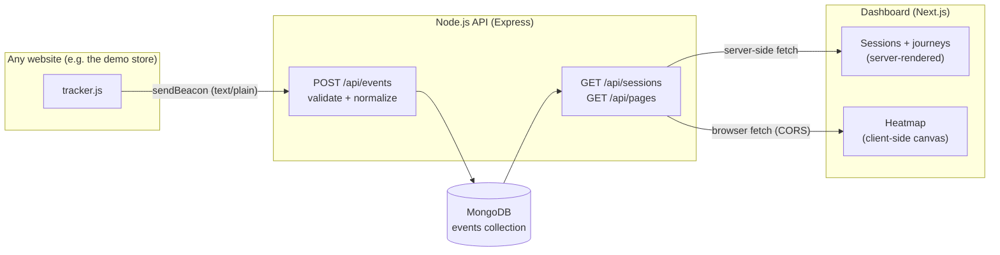

# User Analytics: CausalFunnel Assignment

A small full-stack analytics app. A drop-in JavaScript tracker records page views and clicks, a Node.js API stores them in MongoDB, and a Next.js dashboard shows sessions, user journeys and click heatmaps.

> **Dashboard:** https://causalfunnel-analytics-delta.vercel.app
> **Demo store (tracked):** https://causalfunnel-analytics-api.onrender.com/demo/
> **API:** https://causalfunnel-analytics-api.onrender.com/api/health · **Video walkthrough:** _TBD_
>
> The API runs on Render's free tier and sleeps when idle: the first request after a pause can take up to a minute. The dashboard is pre-filled with clearly labelled **Sample** sessions; click around the demo store and your own session appears alongside them.

## Features

**Tracker** ([`tracker/tracker.js`](tracker/tracker.js), one `<script>` tag, ~2 KB gzipped, no dependencies)
- Tracks `page_view` and `click` events with `session_id`, event type, page URL, timestamp and click x/y.
- Session id in `localStorage`; a new session starts after 30 minutes of inactivity.
- Counts single-page-app navigations (`pushState`/`popstate`) and back/forward-cache restores as page views.
- Sends with `navigator.sendBeacon`, so clicks on links that leave the page are not lost; falls back to `fetch` with `keepalive`.
- Records what was clicked (`a.btn "Add to cart"`), never what was typed into form fields.
- Can't break the host page: every step is guarded, and it is safe to include twice.

**API** ([`backend/`](backend/), Express + MongoDB)
- Receives and validates events (single or batched) and stores them in MongoDB.
- Sessions with event counts, the full event list of a session, and click data per page for the heatmap.
- Also serves `tracker.js` and the demo store.

**Dashboard** ([`dashboard/`](dashboard/), Next.js)
- **Sessions:** every session with totals, duration, entry → exit page and browser, paginated. Click one to see its **journey**: page visits in order, with the clicks made on each page and timings.
- **Heatmap:** pick a page and see where visitors clicked, as dots or as a heat gradient, drawn over a live preview of the page. Filter by device; a "most clicked elements" list gives the same information as text.

**Demo store** ([`demo/`](demo/)): a fictional outdoor-gear shop (home, product, checkout) with the tracker installed, plus a [seed script](#sample-data-optional) that fills the dashboard with realistic sample sessions.

## Tech stack

| Part | Tech |
|---|---|
| Tracker | Vanilla JavaScript (ES5-compatible, no build step) |
| Backend | Node.js 20+, Express 5, TypeScript, Mongoose 9, Zod 4 |
| Database | MongoDB (Atlas free tier) |
| Dashboard | Next.js 16 (App Router, server components), React 19, TypeScript, Tailwind CSS 4 |
| Tooling | npm workspaces, tsx |

## Architecture



## Data model

Everything is stored in a single `events` collection, one document per interaction:

```jsonc
{
  "session_id": "b0fc56d6-2675-4afe-a742-e81bbb9d8d59",
  "event_type": "click",                          // "page_view" | "click"
  "page_url": "https://shop.example/demo/product", // normalized: used for grouping
  "full_url": "https://shop.example/demo/product?id=tent",
  "timestamp": "2026-10-12T14:20:15.035Z",         // client time of the event
  "received_at": "2026-10-12T14:20:15.212Z",       // server time
  "x": 803, "y": 571,                              // clicks only: document coordinates (pageX/pageY)
  "viewport_width": 1280, "viewport_height": 800,
  "page_width": 1265, "page_height": 1264,
  "target": "a#add-to-cart.btn \"Add to cart\"",
  "referrer": "https://www.google.com/",           // page views only
  "user_agent": "Mozilla/5.0 …"
}
```

Sessions are not stored separately. They are computed from events with an aggregation (`$group` by `session_id`), so ingest is a single insert with nothing to keep in sync.

| Index | Serves |
|---|---|
| `{ session_id: 1, timestamp: 1, _id: 1 }` | A session's journey in order, straight from the index with no in-memory sort |
| `{ page_url: 1, event_type: 1, timestamp: -1 }` | Clicks for one page, newest first (heatmap) |
| `{ timestamp: -1 }` | Recency queries |

`page_url` is normalized on ingest: origin + path, without query string or hash, and `/a/`, `/a.html` and `/a/index.html` all become `/a`. The original URL is kept in `full_url`.

## API

| Method | Endpoint | Description |
|---|---|---|
| `POST` | `/api/events` | Store one event or a batch (`{ "events": [...] }`). Accepts JSON or `text/plain` (sendBeacon). Returns `202 { "accepted": n }` |
| `GET` | `/api/sessions?limit=50&offset=0` | Sessions with event counts, most recent first: totals, page views, clicks, unique pages, duration, entry/exit page |
| `GET` | `/api/sessions/:sessionId/events` | All events of a session in time order (the user journey); `404` if unknown |
| `GET` | `/api/pages` | Tracked pages with view, click and session counts (feeds the heatmap page picker) |
| `GET` | `/api/pages/clicks?url=<page_url>&limit=5000` | Click positions for a page, with page and viewport size; raw URLs are normalized like on ingest |
| `GET` | `/api/health` | Health check |

Invalid input returns `400` with the validation issues.

## Project structure

```
.
├── backend/              Express API (TypeScript); also serves tracker.js and the demo store
│   └── src/
│       ├── app.ts            Express app, CORS, static files
│       ├── index.ts          entrypoint (connect DB, start server)
│       ├── config.ts / db.ts env config, MongoDB connection
│       ├── validation.ts     Zod schemas for incoming events
│       ├── models/Event.ts   event schema + indexes
│       ├── lib/              URL normalization, event → document mapping
│       ├── routes/           events, sessions, pages (heatmap)
│       └── scripts/          seed script + measured demo-store layout
├── tracker/tracker.js    the embeddable tracking script
├── demo/                 "Trailhead Supply Co.", the static demo store
└── dashboard/            Next.js dashboard
    └── src/
        ├── app/              routes: /sessions, /sessions/[id], /heatmap
        ├── components/       heatmap canvas + view, shared UI
        └── lib/              API client, types, formatting
```

## Setup

**Prerequisites:** Node.js 20+ and a MongoDB connection string. A free [MongoDB Atlas](https://www.mongodb.com/atlas) cluster works; a local `mongod` works too.

```bash
npm install
cp backend/.env.example backend/.env           # then set MONGODB_URI
cp dashboard/.env.example dashboard/.env.local # API URL, defaults to http://localhost:4000
npm run dev                                    # starts API + dashboard
```

- Demo store (tracked): http://localhost:4000/demo/
- Dashboard: http://localhost:3000

Click around the demo store, then refresh the dashboard.

| Script (repo root) | Does |
|---|---|
| `npm run dev` | API on :4000 and dashboard on :3000, with reload |
| `npm run build` | Compile the API and build the dashboard |
| `npm run typecheck` | Type-check both apps |
| `npm run seed` | Load sample data (see below) |

### Environment variables

| Variable | Where | Default | Purpose |
|---|---|---|---|
| `MONGODB_URI` | backend | (required) | MongoDB connection string |
| `PORT` | backend | `4000` | API port |
| `DASHBOARD_ORIGINS` | backend | `http://localhost:3000` | Comma-separated origins allowed to call the read APIs |
| `NEXT_PUBLIC_API_URL` | dashboard | `http://localhost:4000` | Base URL of the API |

### Sample data (optional)

```bash
npm run seed                                  # 80 sample sessions over the last 14 days
npm run seed -- --sessions 200 --days 30      # more data
npm run seed -- --base-url https://<api-host> # when the demo store is hosted elsewhere
npm run seed -- --clear                       # remove sample data only
```

The seed script simulates visitors moving through the demo store (home → product → checkout, with realistic drop-off) on desktop, tablet and phone. Click positions come from [`demo-layout.json`](backend/src/scripts/demo-layout.json): the clickable areas of each demo page measured in a real browser at 1280px, 820px and 390px, so seeded clicks land on the actual buttons in the heatmap.

Sample sessions are always distinguishable from real traffic: their `session_id` starts with `seed-`, the dashboard tags them **Sample**, and re-running the script replaces only them, never real tracked data.

### Adding the tracker to any page

```html
<script src="https://<api-host>/tracker.js" defer></script>
```

Events go to `/api/events` on the host that serves the script. Add `data-endpoint="…"` to send them elsewhere, or `data-debug` to log each event to the console.

## Deployment

| Part | Host | Config |
|---|---|---|
| API + tracker + demo store | [Render](https://render.com) (free web service) | [`render.yaml`](render.yaml) blueprint |
| Dashboard | [Vercel](https://vercel.com) | Root directory `dashboard` |
| Database | MongoDB Atlas (M0 free, AWS Mumbai) | |

1. **Atlas:** create a database user with `readWrite` on `causalfunnel`, and allow network access from `0.0.0.0/0` (Render has no fixed outbound IP; the connection still requires the user's credentials).
2. **Render:** New → Blueprint → this repo. Set `MONGODB_URI`; leave `DASHBOARD_ORIGINS` for step 4.
3. **Vercel:** import the repo, set Root Directory to `dashboard` and `NEXT_PUBLIC_API_URL` to the Render URL.
4. **Render:** set `DASHBOARD_ORIGINS` to the Vercel URL (the heatmap fetches from the browser, so it needs CORS).
5. Optional: `npm run seed -- --base-url https://<render-app>.onrender.com` to load sample data that points at the hosted demo store.

Render's free tier sleeps after 15 minutes without traffic, so the first request after a pause can take up to a minute while the API wakes up.

## Assumptions & trade-offs

### Tracking

- **What a session is.** A random UUID in `localStorage`, renewed after 30 minutes without activity (the convention most analytics tools use). It is per browser and per site, so the same person on two devices counts as two sessions, and there is no cross-domain tracking. I chose `localStorage` over a cookie because the id never needs to go to the server automatically, which keeps every request cookie-free. If storage is blocked, the tracker keeps an in-memory id for that page load.
- **One request per event, no batching.** `sendBeacon` makes each event independently reliable, even when a click navigates away. Batching would cut request volume on busy pages but risks losing the last batch on unload. The API already accepts batches, so the tracker could switch later.
- **`text/plain` instead of `application/json`.** A JSON content type makes the browser send a CORS preflight request first, which `sendBeacon` cannot do. Plain text avoids that; the server parses it as JSON.
- **Client timestamps.** Events are ordered by the browser's clock, which is what keeps a journey in the right order even if requests arrive out of order. A wrong client clock shifts a whole session; the server's `received_at` is stored as well.
- **Privacy.** No form values and no IP addresses are stored. Click targets only include the visible text of links and buttons. The user agent is stored to show the browser.

### Data & API

- **Sessions computed at read time.** Simple and always consistent, but the session list groups the whole collection on every request. That is fine at assignment scale; with millions of events I would maintain a `sessions` collection with upserts on ingest, or pre-aggregate on a schedule.
- **Page identity ignores the query string.** `/product?id=tent` and `/product?id=jacket` share one heatmap. That fits pages whose layout doesn't depend on the query; sites where it does would need a per-site rule for which parameters matter.
- **Limits.** The heatmap returns the 5,000 most recent clicks per page, and a journey returns at most 1,000 events. Both responses say when they were cut off.
- **No authentication.** The ingest endpoint is public by design, since any site with the script must be able to post to it, which also means anyone could send fake events. The read APIs only restrict browsers via CORS, which is not access control. A production version would add per-site write keys, rate limiting, and a login for the dashboard.

### Heatmap

- **Mapping clicks from different screens.** Clicks are stored in page coordinates together with the page and viewport size. The dashboard draws them on the most common page width, scaling x proportionally and keeping y as recorded. That works well within one device class, but responsive pages rearrange content between phone and desktop, so mixing them is only approximate. The heatmap therefore defaults to the device class with the most clicks and warns when you choose "All devices". Recording the clicked element's position plus the click offset inside it would map across layouts exactly, at the cost of a more complex tracker.
- **Live page preview.** The page behind the dots is the real page in a sandboxed `<iframe>` with scripts disabled, so viewing a heatmap never runs the tracker or creates fake page views. Sites that forbid framing (`X-Frame-Options` / `frame-ancestors`) can't be previewed: the browser shows its blocked-frame message instead, and unticking **Show page** shows the dots on a plain background. A production tool would store a DOM snapshot or screenshot instead.

### Other

- **One deployable backend.** The API also serves `tracker.js` and the demo store, so the whole system runs as two services (API + dashboard) plus the database.
- **Testing.** Verified manually and with scripts against a real MongoDB: API responses and error cases, query plans (both hot queries use their index without sorting in memory), the tracker in a real browser (including link navigation, keyboard clicks and SPA navigation), and that every seeded click lands on its element. There is no automated test suite yet; that would be the next thing to add.

## What I'd do next

- Automated tests: unit tests for URL normalization and heatmap layout, API tests against an in-memory MongoDB.
- Per-site write keys, rate limiting on ingest, and authentication for the dashboard.
- A `sessions` collection maintained on ingest, to keep the session list fast at scale.
- Date-range filters, and funnel/conversion views (the demo store already has a home → product → checkout funnel).
- Element-relative click positions for exact cross-device heatmaps.
